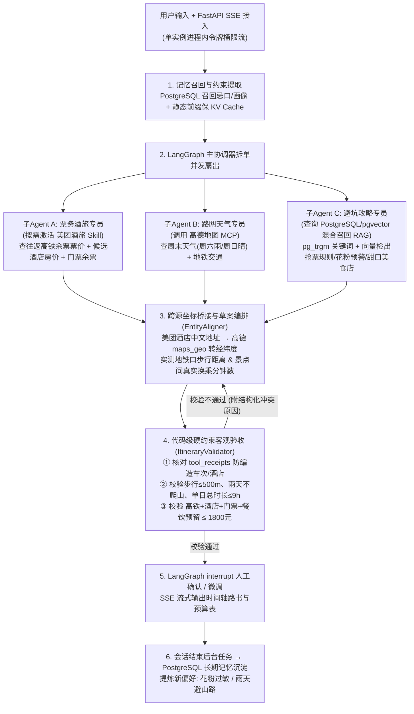

# TripPilot 业务流程与系统架构设计说明书

## 1. 项目定位与核心解决的痛点

普通大模型做旅游行程规划存在三大顽疾：
1. **时空与库存幻觉**：瞎编不存在的车次、推荐已满房或超预算的酒店、安排“半小时跨城瞬移”的魔鬼动线、把景点排在周一闭馆日或暴雨天爬山。
2. **异构工具孤岛与上下文爆炸**：同时挂载地图、票务、攻略 20+ 个工具时，全量塞入 Prompt 既烧钱又容易让模型跳步调错（如没转经纬度就调周边搜索）。
3. **无记忆、无深度避坑经验**：标准地图/票务 API 查不到“提前 7 天 18:00 抢票、夫子庙主街小吃避雷去科巷吃”等人类非标经验，也记不住用户的忌口与作息习惯。

**TripPilot** 结合 **高德官方 MCP + 美团酒旅官方 Skill + PostgreSQL/pgvector 混合召回 RAG + LangGraph 多智能体客观验收**，构建轻量、可验证的旅行规划引擎。当前不引入 Elasticsearch 与 Redis。

---

## 2. 端到端业务流程（以真实复杂需求为例）

> **典型输入案例**：
> *“周五 17:00 后从上海坐高铁去南京玩周末两天（周日晚回），两人总预算 1800 元以内。想去南京博物院、中山陵、夫子庙夜游、先锋书店，酒店选在新街口或大行宫地铁口步行 500 米内。对象花粉过敏，下雨不想走户外山路。”*
> *（历史 Memory 已存画像：`不吃内脏和鸭血，偏爱甜口苏帮菜或面食`）*



---

## 3. 核心技术模块详细设计

### 3.1 工具层：高德 MCP + 美团酒旅 Skill 渐进式治理与坐标桥接
- **能力边界互补**：
  - **美团酒旅 Skill**（置于 `src/skills/meituan-travel/`）：提供实时房态房价、景区门票余票与票价、高铁车次余票。采用**渐进式披露（Progressive Disclosure）**——默认仅向模型暴露 1 行技能简介，命中酒旅票务意图后才加载完整 `SKILL.md` 说明与底层工具 Schema。
- **两侧数据形态不对称（2026-11-25 实测）**：高德 MCP 返回结构化 JSON，拆 `[{type:text,text}]` 后可直接校验；美团 `ht-ai` 的 `data` 字段是**一整段 Markdown**（外层还裹 `<answer>` 标签），无任何结构化字段。因此收据抽取必须按品类分叉：机票/高铁的链接文本形如 `[G94 上海虹桥→南京南 11.27 08:55→09:54 总59m 二等座 ¥162](短链)`，单条正则即可稳定取全；酒店则是散文（`**特惠大床房**每晚约**78元**`，价格用「元」而非「¥」，且与酒店名分行），价格抽不到时必须标记 `PRICE_UNVERIFIED` 并排除出预算核验，而不是让预算静默算错。另需注意：美团业务失败同样可能返回 HTTP 200，必须同时检查 CLI 退出码与响应体 `status`/`data`；实测单次查询约 15-30 秒。
  - **高德地图 MCP**（`https://mcp.amap.com/mcp?key=...`，Streamable HTTP；高德已于 2026-03-17 下线 SSE 传输）：实测暴露 **15 个工具**，分三类。查询类 `maps_geo`、`maps_regeocode`、`maps_ip_location`、`maps_weather`、`maps_text_search`、`maps_around_search`、`maps_search_detail`；路径类 `maps_direction_walking`、`maps_direction_driving`、`maps_direction_bicycling`、`maps_direction_transit_integrated`（跨城必须同时传 `city` 起点城市与 `cityd` 终点城市）、`maps_distance`；唤端类 `maps_schema_personal_map`（行程点位按序填入 `lineList`，返回高德专属地图链接，可直接替代自研路线打点页）、`maps_schema_navi`、`maps_schema_take_taxi`。工具返回值统一是 `[{"type":"text","text":"<JSON>"}]`，拆开后即为结构化数据，可确定性校验。
- **跨源地址坐标桥接（`EntityAligner`）**：
  - 美团返回的酒店/景点仅有中文名与文本地址，无法直接传入高德路径规划。桥接层调用高德 `maps_geo` 转换为 GCJ-02 经纬度。当前不引入 Redis；如后续配额压力明显，可增加单进程 TTL 缓存，但缓存不参与正确性判定。
- **四大洋葱式护栏（借鉴 DeerFlow）**：
  1. `ToolErrorMiddleware`：捕获参数错误（如漏传经纬度格式）转为带恢复提示的 `ToolMessage` 引导模型自纠错；
  2. `ToolOutputBudgetMiddleware`：剥离冗余字段，超 4KB 的长列表自动落盘存 `outputs/`，仅向模型返回精简摘要；
  3. `LoopDetectionMiddleware`：基于“调用参数哈希 + 返回结果哈希”双指纹拦截无效死循环；
  4. `DanglingToolCallMiddleware`：请求前自动修复因用户中途点停止留下的未闭合 `tool_calls`。

### 3.2 知识库层：PostgreSQL/pgvector 混合召回 + Agentic 目录精读（RAG）
针对城市深度避坑指南、景区抢票规则（如“提前 7 天 18:00 放票、周一闭馆”）、馆内精华动线与地道美食清单：

- **存储设计（`trippilot_guides` 表）**：
  - `doc_id`（主键）、`city`、`category`（景区规则 / 美食避坑 / 动线指南）、`title`、`summary`、`content`、`source_id`、`metadata jsonb`；
  - `embedding vector(1024)`：由百炼文本向量模型生成，支撑模糊语义匹配的向量路；
  - PostgreSQL 扩展：`vector` 提供向量类型与 HNSW 索引，`pg_trgm` 提供中文景点名、店名、时间等字面关键词的相似度召回；
  - 索引：`city/category` B-tree 过滤索引、`title/content` 的 `gin_trgm_ops` 索引、`embedding` 的 `vector_cosine_ops` HNSW 索引。
- **混合召回与精排链路**：
  1. **元数据过滤（Pre-filter）**：按目的地 `city = '南京'` 过滤，天然隔离无关城市噪音；
  2. **第一路（关键词召回）**：`pg_trgm` 相似度或 `ILIKE` 召回 Top-20，保留对专有名词和放票时间的字面匹配能力；
  3. **第二路（向量召回）**：pgvector 余弦距离 `<=>` 查询召回 Top-20，使用 HNSW 近似最近邻索引；
  4. **融合与重排**：客户端按文档 ID 去重，使用 **RRF（$\sum \frac{1}{k + \text{rank}_i}, k=60$）** 融合两路名次，再送入百炼 **`gte-rerank` Cross-Encoder** 精排取 Top-5；
  5. **Agentic 按需精读**：同时向上下文注入该城市攻略文档的 `<guides_catalog>` 一句话目录，模型在需要完整游览动线时可主动调用 `read_guide_section(doc_id, offset, limit)` 精读原文，输出强制携带 `[source_id]`。

### 3.3 上下文工程与 PostgreSQL 分工
- **Context Engineering**：
  - **Index 0 静态 System Prompt 零改动**：确保多轮对话和子任务最大化命中 DeepSeek `prompt_cache_hit_tokens`；
  - **瞬时动态注入**：当前日期、用户偏好 `<memory>`、城市攻略目录 `<guides_catalog>` 通过请求视图动态注入，不污染静态前缀；
  - **无损摘要压缩**：超过窗口比例阈值时压缩早期轮次写入独立 `summary_text` 状态字段，并严格对齐 `assistant(tool_calls)` 与 `tool` 消息边界。
- **PostgreSQL 职责**：
  1. `trippilot_guides`：攻略文档、关键词索引、向量索引与溯源元数据；
  2. `AsyncPostgresSaver`：持久化 LangGraph 线程状态快照，支撑多轮微调与 HITL 暂停恢复；
  3. `itineraries`：归档最终路书与确定性验收结果；
  4. `user_memories`：存储用户忌口、预算档位、出行作息等长期事实（带 `version` 乐观锁与访问热度 `access_count`）。
- **当前不引入 Redis**：单进程阶段使用进程内令牌桶限流和 `asyncio` 后台任务完成记忆提炼；如未来多实例部署，再评估 PostgreSQL 任务表或独立队列，不在当前阶段提前增加中间件。

### 3.4 多智能体编排与确定性验收（`ItineraryValidator`）
摒弃“让另一个大模型主观夸一句没问题”的脆弱做法，使用纯 Python 确定性逻辑核查草案：
1. **收据核验（Receipt Check）**：草案中的高铁车次、酒店名称与单价必须能在本次运行的 `tool_receipts` 中找到匹配项，杜绝模型凭空捏造；
2. **空间与时间核验**：所选酒店经高德实测步行距离必须满足用户阈值（如 `≤500m`）；每日 `Σ(景点建议游玩时长) + Σ(高德实测换乘分钟数)` 不超过体力上限（默认 `9h`）；不命中闭馆日或雨天户外禁忌；
3. **预算核验**：`往返交通 + 酒店总价 + 门票总价 + 餐饮预留 ≤ 总预算`。
任一校验失败即生成结构化错误列表（例如 `["酒店A步行至大行宫站实测860m > 500m", "总预算1920元 > 1800元"]`），经 LangGraph 条件边打回重排（最多重试 2 次）。

---

## 4. 推荐仓库目录结构

```text
TripPilot/
├── AGENTS.md                     # AI 协作与项目总纲
├── .env.example                  # 环境变量模板（真实值放 .env，严禁提交）
├── pyproject.toml                # uv 项目依赖配置
├── migrations/                   # vector/pg_trgm 扩展与 PostgreSQL 表结构
├── references/
│   └── skill-archives/           # 不进入运行路径的第三方 Skill 参考样本
├── src/
│   ├── skills/
│   │   └── meituan-travel/       # 下载解压的美团酒旅官方 Skill (SKILL.md + 脚本)
│   └── trippilot/
│       ├── config.py             # Pydantic Settings 配置加载
│       ├── tools/                # 高德 MCP 客户端、美团 Skill 适配器、坐标桥接器
│       ├── middlewares/          # 错误自愈、输出预算裁剪、死循环检测、悬空修复、按需暴露
│       ├── context/              # 静态/动态上下文拼装与无损摘要压缩
│       ├── rag/                  # pgvector + pg_trgm 混合召回、RRF、Rerank、目录精读
│       ├── memory/               # asyncio 后台任务 + PostgreSQL 长期记忆抽取与召回
│       ├── graph/                # LangGraph StateGraph 主图、3 个隔离 Subagent、ItineraryValidator 验收器
│       └── api/                  # FastAPI SSE 流式接口、断连取消、单实例令牌桶限流
├── data/
│   └── guides/                   # 城市背景、交通、景点与餐饮 Markdown 语料
├── tests/                        # 各护栏、RRF、验收器的离线 pytest 单元测试
├── eval/                         # 30 题黄金测试集 (dataset.jsonl) 与消融评测脚本 (run_eval.py)
└── docs/
    ├── ARCHITECTURE_AND_SPEC.md  # 本架构设计文档
    ├── STUDY_TRACKER.md          # 21 天 AI 督学与每日冲刺总控活文档
    └── DEERFLOW_CODE_GUIDE.md    # DeerFlow 五大模块源码精读对照手册
```
