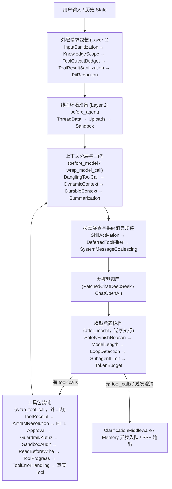

# DeerFlow 源码精读指南：从 `PythonWithAi` 到工业级 Agent Harness

我拉取并读完了你的 `PythonWithAi`（`base_demo` 与 `langchain_demo`）和 `ChatBotDemos`（Spring AI）。这份文档直接以**你已经写过的代码为锚点**，对照拆解字节 DeerFlow（本地位于 `f:\deer-flow`）是如何把同一个模块做到生产级工程标准的。

> [!TIP]
> 阅读建议：点击文中蓝色的文件名链接，可以直接在 IDE 里跳转到 `f:\deer-flow` 对应行号边看边对照。

---

## 0. 全局视角：你的 189 行 `Agent` vs DeerFlow 的洋葱模型

在你的 `PythonWithAi/base_demo/src/core.py` 中，你手写了非常清晰的四层结构：
1. 输入层 `chat()` / `chat_file()`
2. 循环层 `_run_loop()`（`for _ in range(self.max_rounds)` + 轮次超限兜底总结）
3. 单轮模型调用 `_complete()` / `_complete_stream()`（含 `delta.tool_calls` 按 `index` 拼装与 `reasoning_content` 提取）
4. 上下文压缩 `compact()`

DeerFlow 的底层核心循环同样是“调模型 → 跑工具 → 回到模型”（见 [agent.py](file:///f:/deer-flow/backend/packages/harness/deerflow/agents/lead_agent/agent.py#L1336-L1343) 调用的 `create_agent`），但为了不在一个 `core.py` 里堆上万行 `if-else`，它把所有工程能力拆成了 **有严格顺序的 Middleware 责任链**（很像你在 Spring AI `ChatBotDemos` 里用的 `Advisor` 链，但粒度更细）：



**必读入口源码（第一站先读这两个函数）**：
- 主/子智能体共用的基础链：[`_build_runtime_middlewares`](file:///f:/deer-flow/backend/packages/harness/deerflow/agents/middlewares/tool_error_handling_middleware.py#L424-L612)
- 主智能体专属组装链：[`build_middlewares`](file:///f:/deer-flow/backend/packages/harness/deerflow/agents/lead_agent/agent.py#L636-L832)
- 设计铁律说明：[middlewares/AGENTS.md](file:///f:/deer-flow/backend/packages/harness/deerflow/agents/middlewares/AGENTS.md)

---

## 1. Context Engineering（上下文工程）对比精读

### 你在 `core.py` 里已经做对的事与留下的隐患
你在 `core.py` 第 164–189 行的 `compact()` 里已经意识到了两个非常关键的细节：
1. **压缩请求用临时副本**：`self.messages + [{"role": "user", "content": instruction}]`，不污染原对话历史。
2. **工具配对完整性**：`while start > 0 and self.messages[start]["role"] == "tool": start -= 1`，防止把 `tool` 消息和前面的 `assistant(tool_calls)` 切散导致 API 报错 400。

但你的实现在真实生产环境会踩 **4 个大坑**：
1. `self.messages = [{"role": "system", "content": summary}] + kept` 会**把原本的 System Prompt 覆盖掉**，而且每次压缩后开头的 System Prompt 都变了，导致大模型厂商的 **Prefix KV Cache（首字延迟与输入价格打 1~2 折的核心机制）彻底失效**。
2. 动态信息（比如当前时间、用户画像、项目背景）如果直接拼进 System Prompt，也会破坏跨轮次/跨用户的 Prefix Cache。
3. 压缩前被裁掉的历史里如果有用户的重要长期偏好，一旦压缩摘要漏掉就永久丢失了。
4. 不同模型（vLLM / Qwen / Anthropic / DeepSeek）对“能否有多个 `SystemMessage`、能否出现在对话中间”校验极严，很容易炸 400。

### DeerFlow 是怎么解决的（精读这 4 个文件）
1. **静态 System Prompt + 冻结快照式动态注入**：[dynamic_context_middleware.py](file:///f:/deer-flow/backend/packages/harness/deerflow/agents/middlewares/dynamic_context_middleware.py#L1-L40)
2. **压缩摘要与持久上下文解耦（`DurableContext` + `Summarization`）**：[summarization_middleware.py](file:///f:/deer-flow/backend/packages/harness/deerflow/agents/middlewares/summarization_middleware.py) 与 [durable_context_middleware.py](file:///f:/deer-flow/backend/packages/harness/deerflow/agents/middlewares/durable_context_middleware.py)
3. **工具 Schema 与 Skill 延迟加载**：[deferred_tool_filter_middleware.py](file:///f:/deer-flow/backend/packages/harness/deerflow/agents/middlewares/deferred_tool_filter_middleware.py) 与 [skill_activation_middleware.py](file:///f:/deer-flow/backend/packages/harness/deerflow/agents/middlewares/skill_activation_middleware.py)
4. **出口统一合并 SystemMessage**：[system_message_coalescing_middleware.py](file:///f:/deer-flow/backend/packages/harness/deerflow/agents/middlewares/system_message_coalescing_middleware.py)

---

## 2. Tool Use（工具调用与安全工程）五道防线

| 故障场景 | 对应源码文件 | 核心工程技巧 |
| --- | --- | --- |
| 历史残留未配对的 `AIMessage.tool_calls`，下次发消息直接报 400 | [dangling_tool_call_middleware.py](file:///f:/deer-flow/backend/packages/harness/deerflow/agents/middlewares/dangling_tool_call_middleware.py) | 在请求前扫描历史，自动为孤儿 `tool_call_id` 补齐合成的取消态 `ToolMessage` 自愈会话 |
| 工具抛异常导致整个 Agent 崩溃 | [tool_error_handling_middleware.py](file:///f:/deer-flow/backend/packages/harness/deerflow/agents/middlewares/tool_error_handling_middleware.py#L175-L195) | 捕获异常转成 `status="error"` 的结构化 `ToolMessage` 喂回给模型自纠错 |
| 工具返回几十万字撑爆上下文 | [tool_output_budget_middleware.py](file:///f:/deer-flow/backend/packages/harness/deerflow/agents/middlewares/tool_output_budget_middleware.py) | 超预算内容自动落盘，只把头尾摘要 + 文件路径交给模型按需分页读 |
| 模型未读文件直接覆盖写入 | [read_before_write_middleware.py](file:///f:/deer-flow/backend/packages/harness/deerflow/agents/middlewares/read_before_write_middleware.py) | 记录当前版本已读文件指纹，未读先写直接拦截 |
| 模型在同一组参数上反复死循环 | [loop_detection_middleware.py](file:///f:/deer-flow/backend/packages/harness/deerflow/agents/middlewares/loop_detection_middleware.py) | 基于“调用参数哈希 + 返回结果哈希”双指纹检测空转，超限剥离 `tool_calls` 强制收尾 |

---

## 3. RAG、Memory 与 Multi-Agent 精读要点

- **RAG 契约与目录精读**：[knowledge/contract.py](file:///f:/deer-flow/backend/packages/harness/deerflow/knowledge/contract.py)（确定性 SHA-256 `KnowledgeSource` 防捏造引文 + `KnowledgeRequestContext` 租户范围隔离）与 [projects/tools.py](file:///f:/deer-flow/backend/packages/harness/deerflow/projects/tools.py)（一句话目录摘要 + 按需窗口精读，在 `TripPilot` 中与 pgvector 混合召回结合）。
- **长期记忆 DeerMem**：[memory/AGENTS.md](file:///f:/deer-flow/backend/packages/harness/deerflow/agents/memory/AGENTS.md)、[memory_middleware.py](file:///f:/deer-flow/backend/packages/harness/deerflow/agents/middlewares/memory_middleware.py)（会话后异步防抖入队、过滤 `tool_calls` 中间态噪音、源数据与派生检索索引分离）。
- **Multi-Agent 编排与客观验收**：[subagents/executor.py](file:///f:/deer-flow/backend/packages/harness/deerflow/subagents/executor.py)、[capacity.py](file:///f:/deer-flow/backend/packages/harness/deerflow/subagents/capacity.py)、[acceptance_checks.py](file:///f:/deer-flow/backend/packages/harness/deerflow/subagents/acceptance_checks.py)（子智能体不继承父聊天历史，跑完由宿主代码核查 `tool_receipts` 客观验收，绝不轻信子智能体自述）。

---

## 精读打卡与离线单测验证清单（在 `f:\deer-flow\backend` 下执行，无需 API Key）

- [ ] **Day 1（Tool Use 护栏与主链顺序）**：
  ```bash
  uv run pytest tests/test_tool_error_handling_middleware.py tests/test_tool_output_budget_middleware.py -q
  uv run pytest tests/test_loop_detection_middleware.py tests/test_dangling_tool_call_middleware.py tests/test_read_before_write_middleware.py -q
  ```
- [ ] **Day 2（Context Engineering 分层、压缩与延迟过滤）**：
  ```bash
  uv run pytest tests/test_dynamic_context_middleware.py tests/test_durable_context_middleware.py -q
  uv run pytest tests/test_summarization_middleware.py tests/test_deferred_filter_middleware.py -q
  ```
- [ ] **Day 3（RAG 契约与项目文档架）**：
  ```bash
  uv run pytest tests/test_knowledge_contract.py tests/test_knowledge_provider.py tests/test_project_document_tools.py -q
  ```
- [ ] **Day 4（长期记忆与 Multi-Agent 验收）**：
  ```bash
  uv run pytest tests/test_deermem_self_contained.py tests/test_memory_queue.py -q
  uv run pytest tests/test_subagent_executor.py tests/test_subagent_capacity.py tests/test_acceptance_checks.py -q
  ```
