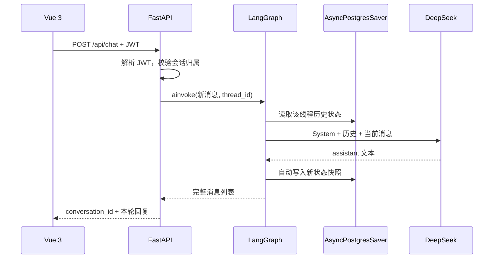

# TripPilot 初版设计：JWT 多轮聊天与 LangGraph Checkpoint 持久化

> 状态：初版设计，待实现  
> 日期：2026-11-26（方案变更：由手动 messages 表改为 AsyncPostgresSaver）  
> 范围：本文是 [系统架构说明书](ARCHITECTURE_AND_SPEC.md) 的可执行子集。初版实现“登录 + 多轮对话 + Checkpoint 持久化 + 最小 Vue 3 页面”，暂不引入实际工具、RAG 和流式输出。

## 一、初版目标

完成一条最小闭环：

```text
Vue 3 页面
  → JWT 认证
  → FastAPI
  → LangGraph 单节点图（thread_id = 会话 ID）
  → AsyncPostgresSaver 自动读写历史
  → 调用 DeepSeek
  → 返回 JSON
```

初版需要满足：

1. 用户登录后获得 JWT。
2. 每个会话绑定一个用户。
3. 同一会话可以连续多轮对话，历史由 Checkpointer 自动维护。
4. 刷新页面后可以恢复当前会话和消息。
5. 后端重启后消息仍然存在。
6. 不同用户之间不能读取彼此会话。

## 二、能力边界

### 包含

- 用户名密码注册与登录，JWT Bearer Token 鉴权。
- `users`、`conversations` 两张业务表（不建 messages 表）。
- LangGraph `StateGraph(MessagesState)` 单节点图。
- `AsyncPostgresSaver` 持久化会话状态。
- 单用户单当前会话。
- 普通 JSON 响应。
- Vue 3 + Vite + TypeScript 最小页面。
- 本地通过 SSH 隧道连接服务器 PostgreSQL。

### 不包含

- SSE 或其他流式输出。
- 高德 MCP、美团 Skill 等实际工具。
- 多节点图、条件边、interrupt。
- 上下文摘要压缩。
- 用户长期记忆。
- pgvector 检索、Rerank。
- 多智能体、行程确定性验收。
- 会话列表、搜索、重命名等完整管理功能。

## 三、关键设计决策

| 决策 | 初版方案 | 原因 |
| --- | --- | --- |
| 上下文存储 | `AsyncPostgresSaver` | 历史消息随图状态自动持久化，不手动维护消息行 |
| 业务表 | 只保留 `users`、`conversations` | Checkpoint 快照不可按业务查询，会话归属仍需业务表 |
| 会话标识 | `thread_id = conversations.id` | UUIDv7，应用层生成（时间有序，利于 B-tree 写入），一个会话对应一个 LangGraph 线程 |
| 用户身份 | 以 JWT 的 `uid` 为准 | 请求体不携带 `user_id`，身份完全取自令牌 |
| System Prompt | 节点内临时拼接，不写入状态 | 避免每轮重复追加系统消息 |
| 编排框架 | 单节点 `StateGraph` | 为后续工具节点、条件边预留结构 |
| 响应方式 | 普通 JSON | 暂不处理流式分片、断连和前端增量渲染 |
| 前端状态 | `localStorage` | 足够支撑初版单页面演示 |

### 为什么不用手动 messages 表

- Checkpointer 自动保存每轮消息，省去查历史、拼上下文、写回两条消息的手动逻辑。
- 后续加工具节点、interrupt 时，状态持久化不用重写。
- 代价：历史消息存在序列化快照里，不能直接 SQL 查询；初版没有会话搜索需求，可以接受。
- 若未来需要会话搜索、审计等业务功能，再评估补建 messages 表，避免长期双写。

## 四、总体流程



## 五、数据模型

### 1. `users`

| 字段 | 类型 | 约束 | 说明 |
| --- | --- | --- | --- |
| `id` | `bigint` | 主键，自增 | 用户 ID |
| `username` | `varchar(50)` | 非空，唯一 | 登录名 |
| `password_hash` | `text` | 非空 | 密码哈希 |
| `created_at` | `timestamptz` | 非空，默认当前时间 | 创建时间 |

密码必须使用 Argon2 或 bcrypt 等算法哈希后存储，不能保存明文。

### 2. `conversations`

| 字段 | 类型 | 约束 | 说明 |
| --- | --- | --- | --- |
| `id` | `uuid` | 主键 | 会话 ID（UUIDv7，应用层生成），同时作为 LangGraph `thread_id` |
| `user_id` | `bigint` | 非空，外键 → `users.id` | 会话所属用户 |
| `title` | `varchar(200)` | 非空，默认“新会话” | 会话标题 |
| `create_time` | `timestamptz` | 非空，默认当前时间 | 创建时间 |
| `update_time` | `timestamptz` | 非空，默认当前时间 | 最近对话时间，应用层每轮更新 |

索引与约束：

- 索引 `(user_id, update_time DESC)`。
- 删除用户时级联删除其会话。

### 3. Checkpoint 表

由 `AsyncPostgresSaver.setup()` 自动创建和维护，包括 `checkpoints`、`checkpoint_blobs`、`checkpoint_writes`、`checkpoint_migrations`。业务代码不直接读写这些表。

### 4. 归属校验

`thread_id` 本身不带权限。任何拿到会话 ID 的人都能通过 Checkpointer 读到历史，因此每次请求必须先查 `conversations`，确认 `user_id` 与 JWT 一致，再调用图。

## 六、认证与权限

### 1. 登录流程

1. 用户提交用户名和密码。
2. 后端查询用户并校验密码哈希。
3. 签发 JWT，payload 包含 `sub`（用户名）、`uid`（用户 ID）、`exp`。
4. 前端保存 Token，后续请求携带 `Authorization: Bearer <JWT>`。

初版只实现 Access Token，不实现 Refresh Token。Token 过期后重新登录。

### 2. 用户身份规则

1. 真实用户 ID 从 JWT 的 `uid` 获取，请求体不携带 `user_id`。
2. 会话不存在或不属于当前用户时，统一返回 404（不暴露会话是否存在）。

### 3. 前端 Token 存储

初版使用 `localStorage` 保存 JWT。后续如需降低 XSS 风险，可改为 HttpOnly Cookie。

## 七、API 设计

API 字段统一使用 snake_case。

### 1. 注册

```text
POST /api/register
```

请求：`{ "username": "demo", "password": "your-password" }`  
响应：`{ "id": 1, "username": "demo" }`

### 2. 登录

```text
POST /api/login
```

请求：`{ "username": "demo", "password": "your-password" }`  
响应：`{ "access_token": "<JWT>", "token_type": "bearer" }`

### 3. 当前用户

```text
GET /api/me
Authorization: Bearer <JWT>
```

### 4. 发送消息

```text
POST /api/chat
Authorization: Bearer <JWT>
```

请求：

```json
{
  "conversation_id": null,
  "message": "帮我规划杭州两天"
}
```

第一次发送时 `conversation_id` 为 `null`，后端创建会话。后续请求传上一次返回的会话 ID。

响应：

```json
{
  "conversation_id": "会话 UUID",
  "content": "模型返回的行程建议"
}
```

### 5. 获取历史消息

```text
GET /api/conversations/{conversation_id}/messages
Authorization: Bearer <JWT>
```

后端通过 `graph.aget_state(config)` 读取线程状态，把 `messages` 转成 JSON 返回：

```json
{
  "conversation_id": "会话 UUID",
  "messages": [
    { "role": "user", "content": "帮我规划杭州两天" },
    { "role": "assistant", "content": "模型返回的行程建议" }
  ]
}
```

### 6. 错误约定

| 状态码 | 场景 |
| --- | --- |
| 401 | 未登录、Token 无效或过期 |
| 404 | 会话不存在或不属于当前用户 |
| 422 | 请求参数校验失败 |
| 502 | 大模型调用失败 |

## 八、后端实现要点

### 1. 应用生命周期

在 FastAPI `lifespan` 中：

1. 用 `AsyncPostgresSaver.from_conn_string(settings.postgres_uri)` 打开连接。
2. `await saver.setup()` 初始化 Checkpoint 表（幂等）。
3. 编译单节点图并挂到 `app.state`。
4. 应用退出时由上下文管理器自动关闭连接。

### 2. 单节点图

- 状态类型：`MessagesState`，内置 `add_messages` 归并逻辑，每轮只传新消息，历史自动合并。
- 节点 `call_model`：
  - 临时拼接 `SystemMessage + state["messages"]` 调用模型。
  - 只返回模型响应，不把 SystemMessage 写回状态。
- 边：`START → model → END`。
- `compile(checkpointer=saver)`。

### 3. 请求处理顺序

1. 解析并验证 JWT，得到 `uid`。
2. `conversation_id` 为空则创建会话（UUIDv7），否则校验归属。
3. `config = {"configurable": {"thread_id": conversation_id}}`。
4. `await graph.ainvoke({"messages": [HumanMessage(...)]}, config)`。
5. 更新 `conversations.update_time`，返回结果。

模型调用失败时返回 502；失败轮次的状态是否落库由 LangGraph 决定，初版不额外处理。

### 4. Windows 事件循环

- psycopg 异步模式不支持 `ProactorEventLoop`。
- 实测 uvicorn 行为：`--reload`（子进程模式）使用 `SelectorEventLoop`，可正常运行；不带 `--reload` 时使用 `ProactorEventLoop`，会报错。
- 初版开发统一使用 `--reload` 启动；生产部署方式后续单独评估。

## 九、Vue 3 前端设计

### 1. 技术选型

Vite + Vue 3 + TypeScript + 原生 `fetch`。初版不引入 Pinia、Vue Router 和 UI 组件库。

### 2. 页面组成

- 未登录：登录/注册表单。
- 已登录：消息列表、输入框、发送按钮、新会话按钮。

### 3. 本地保存

`localStorage` 保存 JWT、当前用户 ID、当前 `conversation_id`。

### 4. 页面行为

1. 登录成功后保存 Token 和用户 ID。
2. 首次发送消息时 `conversation_id` 传 `null`，收到响应后保存会话 ID。
3. 刷新页面时按会话 ID 拉取历史消息。
4. 点击“新会话”清空消息和会话 ID。
5. 请求进行中禁用发送按钮。
6. 收到 401 时清理登录状态并回到登录页。

开发环境使用 Vite Proxy 将 `/api` 转发到 `http://127.0.0.1:8000`。

## 十、本地连接服务器 PostgreSQL

服务器已部署 `trippilot-postgres` 容器（PostgreSQL 17 + pgvector），5432 仅绑定服务器回环地址，数据卷 `trippilot-pgdata`。

本地建立 SSH 隧道：

```powershell
ssh -fN -o ExitOnForwardFailure=yes -o ServerAliveInterval=30 -o ServerAliveCountMax=3 -L 15432:127.0.0.1:5432 root@<服务器IP>
```

本地 `.env`：

```dotenv
POSTGRES_URI=postgresql://trippilot:<password>@127.0.0.1:15432/trippilot
```

要求：

- 云服务器安全组不开放 5432，仅保留 SSH 22。
- 真实密码只放 `.env`，不得提交到 Git。
- 直接使用 psycopg 时连接串用 `postgresql://`；SQLAlchemy 才用 `postgresql+psycopg://`。

## 十一、配置项

```dotenv
SECRET_KEY=<random-secret>
ALGORITHM=HS256
ACCESS_TOKEN_EXPIRE_MINUTES=30
POSTGRES_URI=postgresql://trippilot:<password>@127.0.0.1:15432/trippilot
```

现有 `DEEPSEEK_API_KEY`、`DEEPSEEK_BASE_URL`、`DEEPSEEK_MODEL` 继续使用。所有密钥只保存在 `.env`。

## 十二、验收清单

- [ ] 用户可以注册并登录，获得 JWT。
- [ ] 未登录或 Token 过期时返回 401。
- [ ] 第一轮消息自动创建会话并返回 `conversation_id`。
- [ ] 同一会话第二轮能使用第一轮上下文。
- [ ] 刷新页面后能恢复历史消息。
- [ ] 新建会话后不会携带旧会话上下文。
- [ ] 后端重启后历史消息仍然存在。
- [ ] 用户不能读取其他用户的会话。
- [ ] `checkpoints` 等表由 `setup()` 自动创建。

## 十三、后续演进

1. 在图中增加高德 MCP 工具节点与工具循环。
2. 增加上下文摘要和 Token 预算管理。
3. 增加 SSE 流式输出与断连取消。
4. 增加 pgvector 混合召回。
5. 增加多智能体与确定性行程验收。
6. 如出现会话搜索、审计等业务需求，再评估补建 messages 表。
