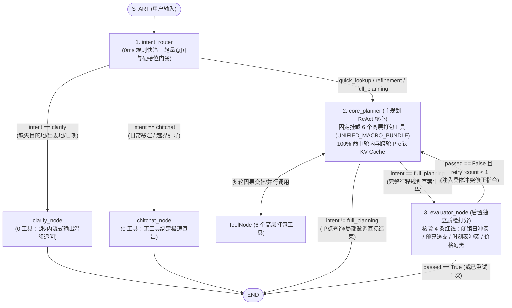

# TripPilot 意图识别、高层工具打包与纵向多节点质检架构规范

本文档沉淀 `TripPilot` 在完成上下文锯齿形压缩（Context Compaction）与多轮交错时间轴（Timeline）之后的下一阶段核心架构设计：**高层复合工具打包（Macro-Tools）**、**两级意图识别与最小槽位门禁（IntentRouter）**、以及 **纵向三段式编排与结束打分自愈闭环（IntentRouter -> Core Planner -> Evaluator）**。

---

## 一、 设计背景与架构取舍（为什么否决“按吃住行游水平拆分子智能体”）

### 1.1 真实业务痛点复盘
在实测单主 Agent 挂载全部 14 个原始工具（2 个联网工具 + 1 个美团酒旅 Skill + 11 个高德官方 MCP 工具）跑完整行程规划时，暴露出四个核心工程问题：
1. **原子工具过度碎片化（14 个工具，高德占 11 个）**：
   - `maps_text_search` 只返回 POI 名称与 ID，不含评分（`rating`）与营业时间/闭馆日（`opening_hours`），模型必须再多跑一轮 `maps_search_detail`。
   - 路线规划被拆成 `transit`（公交地铁）、`driving`（驾车）、`walking`（步行）、`bicycling`（骑行）、`distance`（距离）5 个工具，且**全部只接受 `"lon,lat"` 坐标字符串，不接受中文地名**。轻量模型（`thinking=False`）极易直接传入中文地名报错，或误用仅支持精确门牌号的 `maps_geo` 搜景点。
2. **朴素的“按轮动态增删工具”会彻底击穿 Prefix KV Cache**：
   - 大模型底层将 `[System Prompt] + [Tools JSON Schema]` 拼接在 Token 序列最开头（Index 0）。若每轮对话动态挑选不同工具子集，前缀改变会导致上万 Token 的历史对话 KV Cache 命中率瞬间归零。
3. **缺少前置意图与槽位门禁**：
   - 用户仅输入“你好”或“我想去南京玩（未提供出发地与出行时间）”，若直接放行调工具，模型会盲目猜测日期去调耗时 15~20 秒的美团机票/酒店 CLI。
4. **LangGraph 双模式流式下的“内部 LLM 串台泄露”**：
   - 在 `stream_mode=["messages", "updates"]` 下，若内部辅助 LLM（意图分类器、上下文摘要器、结束打分器）未做流式隔离，其输出的内部 JSON Token 会被直接吐进前端用户聊天框。

### 1.2 核心架构决策：为什么否决“交通 Agent / 酒店 Agent / 景点 Agent / 美食 Agent”水平拆分？
市面上常见的 Demo 喜欢按工具领域水平拆分为“交通子智能体 + 酒店子智能体 + 景点子智能体 + 美食子智能体”，但在真实旅行规划中，这是一种典型的 **负收益反模式（Anti-Pattern）**：
1. **强因果交织依赖（Interleaved Causal Dependency）**：
   - 真实规划中：第 1 轮查日期与天气 ──► 第 2 轮查往返航班时刻（例如发现**周六 13:55 才落地、周一早上 08:40 就要返程起飞**，从而得知周一根本没有游玩时间，实际仅 1.5 天）──► 第 3 轮基于“仅 1.5 天且剩余预算充足”决定将酒店选在景区核心（夫子庙），并检索历史古迹 ──► 第 4 轮核实景点周一闭馆与预约放票时间。
   - **若水平并行跑子智能体**：景点 Agent 在不知道航班起降时刻、不知道酒店位置的情况下排出的 3 天满档行程与通勤路线 **100% 是废案**。
   - **若水平串行轮流唤醒子智能体**：主 Agent 与多个子 Agent 之间反复“派发任务 + 总结汇报”，不仅每次跨 Agent 切换都会**彻底粉碎 Prefix KV Cache**，还会使端到端延迟翻倍，并在多级摘要传话（Telephone Game）中丢失航班时刻、放票时间等关键细节。
2. **用“纵向流水线分工 + 高层复合工具打包”替代水平领域拆分**：
   - 将多步强耦合的底层原子工具（如“搜 POI + 补详情”、“中文地名转坐标 + 算路线”）在代码层打包为确定性的**高层复合工具（Macro-Tools）**；
   - 由**单一高内聚主规划核（Core Planner）**固定挂载浓缩后的高层工具集，掌握全局上下文并享受 **100% 连续命中的 Prefix KV Cache**；
   - 在主规划核**之前**设 `IntentRouter`（前置意图与槽位门禁），在主规划核**之后**设 `EvaluatorNode`（后置独立质检与自愈闭环），形成**纵向三段式多节点协同架构**。

---

## 二、 核心设计一：高层复合工具打包（Macro-Tools，14 合 6）

在 `src/trippilot/tools/bundles.py` 中，用**确定性的 Python 异步编排代码**吃掉高德 MCP 的“多步坐标转换”与“ID 查详情”胶水逻辑，将 11 个细碎的高德原子工具收敛为 **3 个高层空间工具**，与美团酒旅及联网工具组成**全局固定挂载的 6 个高层工具（`UNIFIED_MACRO_BUNDLE`）**：

| 序号 | 挂载的高层工具名 | 内部聚合的底层原子工具与确定性编排逻辑 | 解决了什么痛点 |
| --- | --- | --- | --- |
| 1 | `meituan_travel_search` | 美团官方酒旅 Skill CLI（机票 / 高铁 / 酒店实时报价与预订链接） | 单一入口负责所有大交通票务与酒店实时报价 |
| 2 | `maps_weather` | 高德 `maps_weather` | 查出发地与目的地多日天气预报与温差 |
| 3 | `discover_places` *(复合打包)* | 封装 `maps_text_search`（关键词搜）与 `maps_around_search`（周边搜），并在拿到候选 POI 列表后，**内部自动使用 `asyncio.gather` 并发调用 `maps_search_detail` 补齐 Top-N（默认前 5 个）POI 的权威坐标 `location`、评分 `rating` 与营业时间/闭馆日 `opening_hours`** | **2 轮 ReAct 变 1 轮**：一次调用直接拿齐景点/美食列表 + 评分 + 周一闭馆信息，彻底杜绝模型漏查详情 |
| 4 | `plan_commute_route` *(复合打包)* | 接收中文起止地名或坐标（`origin`, `destination`, `city`, `cityd`, `mode="transit" \| "driving" \| "walking" \| "bicycling"`）。**若检测到输入非 `"lon,lat"` 坐标格式，内部自动并发调用高德检索将其解析为权威 POI 坐标（兜底 `maps_geo`），随后直接调用对应的地铁公交/驾车/步行路线规划或距离测算** | **彻底消灭坐标格式报错与工具选型失误**：屏蔽 9 个底层高德工具的选型干扰，2~3 轮 ReAct 变 1 轮 |
| 5 | `web_search` | DeepSeek 联网搜索 | 查博物馆放票规则、官方预约渠道与最新避坑攻略 |
| 6 | `web_fetch` | 网页正文抓取 | 配合 `web_search` 读取具体官方公告长文 |

### 工程收益：
1. **100% 抢救跨轮次与轮内 Prefix KV Cache**：全局永远固定挂载这 6 个高层工具（按固定顺序排列），不管是第 1 轮做完整规划、第 2 轮换酒店、第 3 轮算地铁通勤耗时，工具 Schema 前缀 **1 个字节都不变**，Prefix KV Cache 100% 连续命中。
2. **轻量模型（`thinking=False`）零选型失误**：工具数从 14 个减至 6 个且职责完全正交，模型不再需要自己维护“先查 ID -> 再查坐标 -> 再调路线”的多步状态机。

---

## 三、 核心设计二：两级意图识别与“最小必填槽位”门禁（`IntentRouter`）

在 LangGraph 入口（`START -> intent_router`）设置两级混合路由器，遵循 **“最小必填槽位原则（Minimal Viable Slots）”**——只拦截真正无法执行查询的硬缺项，绝不做烦人的“查户口式追问”。

### 3.1 意图枚举与槽位定义（Pydantic Schema）

```python
class TravelSlots(BaseModel):
    """从多轮对话中累积提取的旅行核心槽位。"""
    origin: str | None = None          # 出发城市
    destination: str | None = None     # 目的地城市
    date_or_days: str | None = None    # 出行日期或天数
    travelers: str | None = None       # 出行人数与同行关系（可选软槽位）
    budget: str | None = None          # 预算上限（可选软槽位）
    preferences: str | None = None     # 偏好（可选软槽位）


class IntentClassification(BaseModel):
    """前置意图识别与槽位门禁判定结果。"""
    intent: Literal[
        "chitchat",       # 纯日常寒暄、问候、身份询问或非旅行越界请求
        "clarify",        # 想做完整行程规划或查跨城票务，但缺失硬性必填槽位
        "quick_lookup",   # 单点查询（只查某地天气、某景点、某段路线、或单查某地酒店）
        "refinement",     # 在已有行程方案上做局部调整（换酒店、换景点、调整某天安排）
        "full_planning",  # 核心硬槽位齐备的完整多日行程规划
    ]
    slots: TravelSlots = Field(default_factory=TravelSlots)
    missing_hard_slots: list[str] = Field(default_factory=list)
    clarify_question: str | None = None
```

### 3.2 最小必填槽位门禁规则（Minimal Viable Slots）

| 意图类别 | 硬性必填槽位（缺失才拦截转 `clarify`） | 软槽位（缺失不拦截，按合理默认值先行规划） |
| --- | --- | --- |
| **`quick_lookup`（单点快查）** | 仅需具备查询目标（如城市名或景点名）即可直接放行 | 出发地、日期、人数、预算均不追问 |
| **`refinement`（局部微调）** | 历史上下文已有行程，直接放行 | 复用历史槽位 |
| **`full_planning`（完整多日规划）** | 1. **`destination`（目的地）** 必填（除非明确让推荐目的地）；<br>2. **`origin`（出发地）** 与 **`date_or_days`（日期/天数）** 至少需具备或补齐，否则无法查询真实往返机票/高铁与酒店排期 | **`travelers`（默认 1~2 人）**、**`budget`（默认舒适高性价比）**、**`preferences`（默认经典必游）** 缺失时**绝不拦截追问**，直接先出方案并在结尾提示可按需调整 |

### 3.3 保护 KV Cache 的“尾部瞬态引导（Ephemeral Tail Hint）”

- 当 `IntentRouter` 放行至 `Core Planner` 时，**绝不修改第 0 条 `SystemMessage` 和固定的 6 个高层工具**。
- 仅在当次调用 `chosen_model.ainvoke(model_messages)` 的**最后一条 `HumanMessage` 内存副本末尾**追加一行简短的 `[系统路由提示：当前意图=...，已提取槽位=...]`（**不写入 LangGraph `state["messages"]` 持久化数据库**），确保历史前缀 100% 字节级不变。

---

## 四、 核心设计三：纵向三段式拓扑与流式自愈质检（`EvaluatorNode`）



### 4.1 `EvaluatorNode` 如何与前端“实时流式输出（Streaming）”完美配合？

为了**不牺牲首字响应时间（TTFT）与流式打字机体验**：
1. `core_planner` 在生成完整路书时，**照常实时流式推送给前端**（用户无需面对空白屏幕干等 2000 字全部生成完）。
2. 当 `core_planner` 最后一轮文本吐完后，若当前为 `full_planning`，自动进入 `evaluator_node`（使用 `thinking=False`、`disable_streaming=True` 的轻量质检模型 + 规则校验，耗时 ~1s）：
   - **90%+ 正常情况（`passed == True`）**：质检通过，直接 `END` 结束流，用户毫无延迟感知。
   - **触发红线情况（`passed == False`，例如不小心把周一闭馆的南京博物院排在了周一、或总预算超支）**：
     - `evaluator_node` 向前端发送一条 `step` 事件（展示质检发现的冲突项），并将修正指令带回 `core_planner`；
     - `core_planner` 在刚才的回答下方**流式追加一段 `## 🔧 行程质检自动修正说明`**，给出修正后的当日安排或预算替换方案（最多触发 1 次，杜绝死循环）。

---

## 五、 分步落地路线

1. **Step 1：高层复合工具打包层（`src/trippilot/tools/bundles.py` + `tests/test_tool_bundles.py`）**
   - 实现 `discover_places` 与 `plan_commute_route`，将 14 个原子工具打包收敛为 6 个高层工具。
2. **Step 2：两级意图识别与最小槽位门禁（`src/trippilot/graph/intent.py` + `tests/test_intent_router.py`）**
   - 实现 0ms 规则快筛 + 轻量结构化槽位识别 + `clarify_node` 秒级追问拦截 + 内部 LLM 流式串台隔离。
3. **Step 3：后置质检打分与自愈闭环（`src/trippilot/graph/evaluator.py` + `tests/test_evaluator.py`）**
   - 实现 4 条红线打分校验与最多 1 次的流式自愈追加修正。
